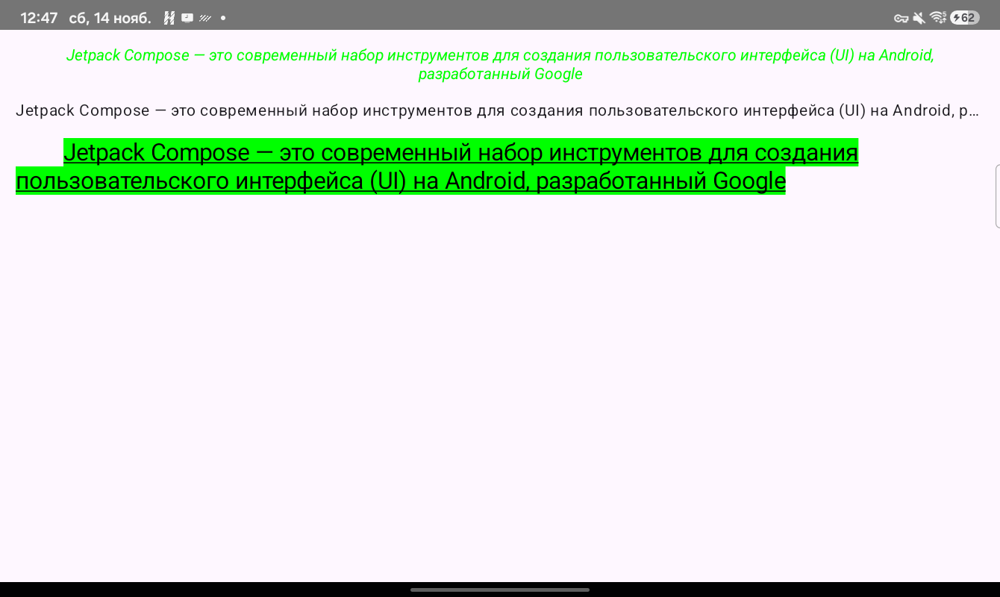

# Text Preview на Jetpack Compose

Учебный проект: стилизация текста с помощью `Text` и `TextStyle`.

## Что показывает приложение

Одна и та же строка из строкового ресурса `jetpack_text`, выведенная в трёх вариантах:

- зелёный шрифт, размер 16.sp, курсив, выравнивание по центру;
- одна строка с многоточием: `maxLines = 1` и `overflow = TextOverflow.Ellipsis`;
- шрифт 24.sp, чёрный текст на зелёном фоне, подчёркивание, отступ первой строки 48.sp.

## Скриншот



## Файлы

- `app/src/main/java/ru/yandex/practicum/helloworld/TextPreview.kt` - активити, показ текста и `@Preview`.
- `app/src/main/res/values/strings.xml` - строковый ресурс `jetpack_text`.

## Сборка

```bash
./gradlew :app:assembleDebug
```

APK: `app/build/outputs/apk/debug/app-debug.apk`.
